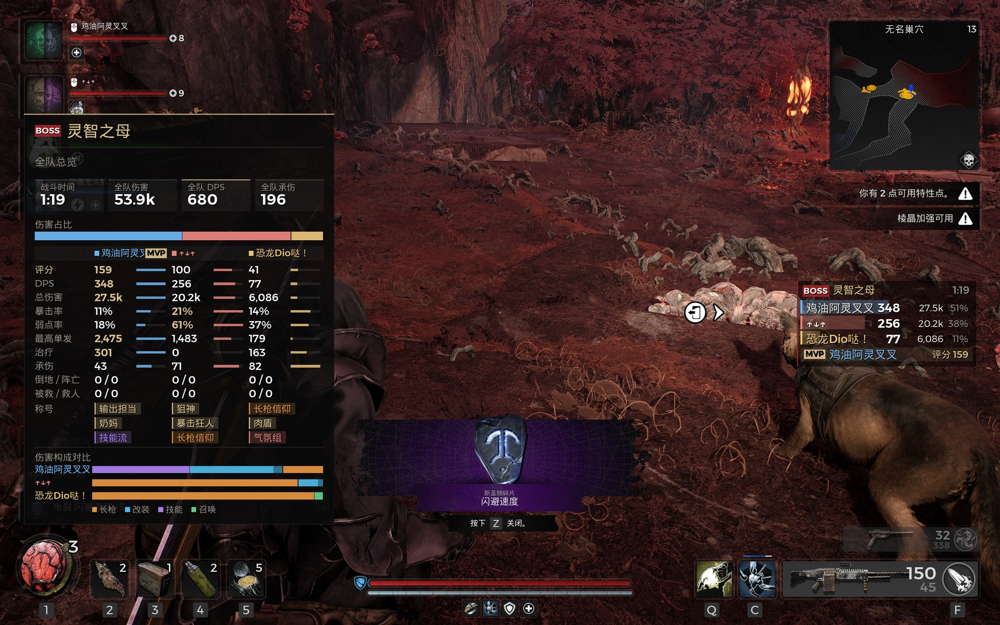
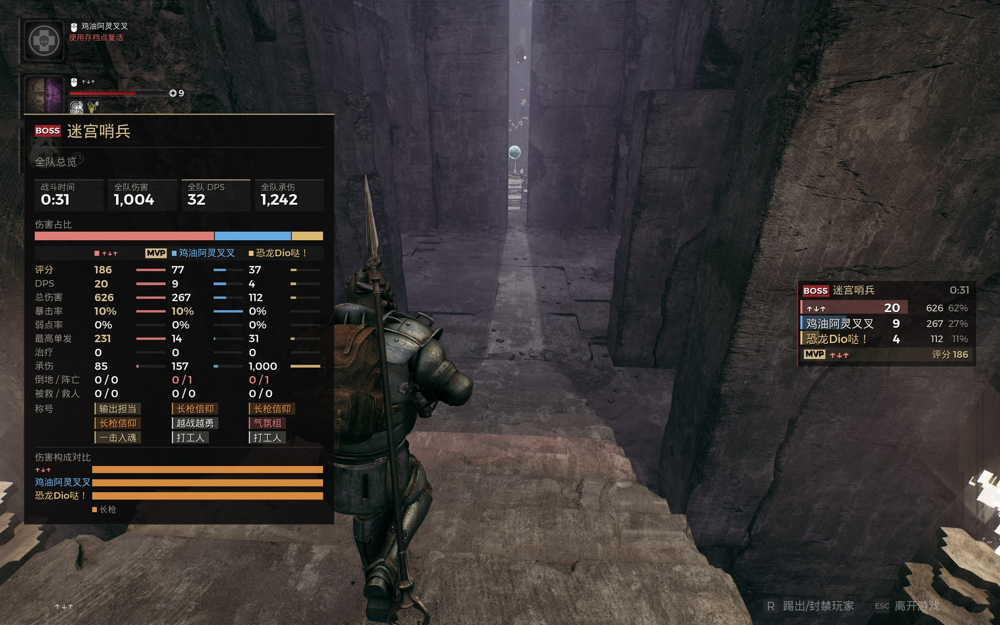

# Remnant 2 DPS Meter（R2DPS）

遗迹2（Remnant II）伤害统计 mod：联机时实时显示全队每个人的 DPS、总伤害和伤害构成，打完 boss 还能翻历史、看 MVP。基于 [UE4SS](https://github.com/UE4SS-RE/RE-UE4SS) 的 Lua 脚本，**只需要房主装**。

> **English:** A damage meter for Remnant II (UE4SS Lua mod). Shows live DPS, total damage, damage breakdown and an MVP score for every player in co-op. Only the host needs to install it. **The UI is Chinese-only for now**; an English UI that follows the game language is planned for the next version.

## 下载

到 [Releases](https://github.com/OzakiJUN/Remnant2-DPS-Meter/releases/latest) 下载 `R2DPS_Setup_v1.0.0.zip`。安装包自带 UE4SS，解压就能装，不用另外联网。

不要用仓库页面绿色的 Code → Download ZIP：那个是源码，不带 UE4SS，安装时会尝试去 GitHub 下载最新版 UE4SS。

## 功能

- **小 HUD**（右上角小地图下面）：每人一行，名字、实时 DPS（最近 5 秒）、总伤害、占比。不挡鼠标。
- **战斗中的详细面板**：点一下 H 一直开着，再按一下关掉；按住 H，松开就收起。多人时显示全队总览。
- **Tab 菜单碎片页的完整面板**：可以点，能翻看 boss / 精英战的历史，切换看每个人的页面。
- **伤害构成**：分长枪 / 手枪 / 近战 / 改装 / 技能 / 召唤，流血、燃烧这类持续伤害单独标出，每类列出来源武器和改装。
- **统计规则**：召唤物的伤害算到召唤者头上；改装伤害、状态伤害都算进去；只算真正扣掉的血，不算溢出伤害。
- **其他数据**：承伤、治疗、倒地、被救、救人、阵亡，以及 DPS 曲线。
- **MVP 评分和趣味称号**：输出担当、狙神、奶妈、气氛组……
- **自动分场**：顶上出现 boss / 精英血条就算一场，用血条上的名字（游戏官中）做标题，存进历史。
- **可调设置**：位置、字号、热键、颜色都在 `config.txt` 里改；1080p 基准，2K / 4K 自动缩放。

## 安装

1. 退出游戏。
2. 解压安装包，双击 `Install.bat`。
   - 会自动找到 Steam 版遗迹2，找不到时让你把游戏文件夹拖进窗口。
   - 没装 UE4SS 就装上自带的；装了但版本太旧会提示升级，旧的先整个备份。
   - 游戏装在 `C:\Program Files (x86)` 之类的地方时会弹管理员权限确认，点"是"。
   - 再次运行就是更新，你改过的设置会保留。
3. 启动游戏。

卸载：双击 `Uninstall.bat`。

## 联机说明

**只需要房主装，队友不用装。** 游戏只把全队的伤害数据发给房主，所以房主的面板能统计所有人。你进别人的房间时，mod 会自动停用（不统计、不显示），回到自己当房主或单人时自动恢复。

## 设置

设置文件在 `游戏目录\Remnant2\Binaries\Win64\ue4ss\Mods\R2DPS\config.txt`，常用的几项：

| 设置 | 说明 |
|---|---|
| `detail_key` | 详细面板热键，默认 `H` |
| `detail_key_mode` | `auto`：点按常开、按住松开就收；`hold`：只在按住时显示；`toggle`：按一下开、再按一下关 |
| `hud_offset_x` / `hud_offset_y` | 小 HUD 的位置 |
| `animations` | `0` 关掉动画 |
| `damage_mode` | `health`：只算扣掉的血（默认）；`raw`：算满额伤害 |
| `ui_enabled` | `0`：只统计不显示，排查问题用 |

武器、改装、技能的中文名在 `names.txt` 里，遇到没收录的名字会自动记到同一文件夹的 `names_todo.txt`。

## 已知限制

- 界面目前只有中文。
- 只支持键鼠，不支持手柄。
- 只在 Steam 版上测试过。
- 进别人的房间时不统计（游戏不把别人的伤害发给队友）。
- `names.txt` 里一部分名字是暂译，和游戏里不一样的话可以直接改，也欢迎提 issue。

## 遇到问题

1. 闪退的话，先把 `config.txt` 里的 `ui_enabled` 改成 `0` 再试。
2. 到 [Issues](https://github.com/OzakiJUN/Remnant2-DPS-Meter/issues) 反馈，附上：
   - `ue4ss\Mods\R2DPS\R2DPS_debug.txt`（游戏装在中文路径下时，在 `%LOCALAPPDATA%\Remnant2\Saved\Logs` 里）
   - 闪退时 `ue4ss` 文件夹里最新的 `crash_*.dmp`
3. 发日志前别重开游戏：每次启动游戏，日志都会被清空重写。

## 许可证与致谢

- 本 mod 使用 [MIT 许可证](LICENSE)。
- 安装包自带的 [UE4SS](https://github.com/UE4SS-RE/RE-UE4SS) 同样是 MIT 许可证，见 [THIRD_PARTY_NOTICES.md](THIRD_PARTY_NOTICES.md)。
- 这是非官方 mod，与 Gunfire Games 及游戏发行商无关，使用风险自负。
